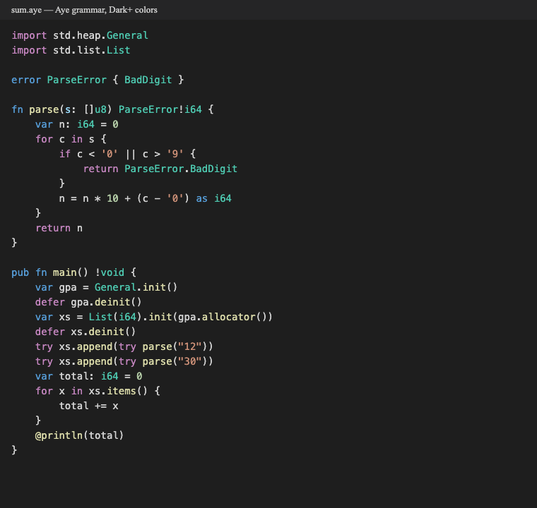

# Aye for Visual Studio Code

Support for [Aye](https://ayelang.dev), a small systems language without a
GC, built so AI agents can learn it from one command.



## Features

- **Syntax colors** for `.aye` files, from the compiler's own lexer:
  keywords, primitive types, `@builtins`, numbers, strings and escapes,
  multi-line `\\` strings, characters, `//` and `///` comments.
- **Editing**: bracket matching and colorizing, `//` comment toggling,
  auto-closing pairs, indentation.
- **Snippets**: `main`, `fn`, `struct`, `enum`, `error`, `match`, `for`, `test`.
- **Language server** (`aye lsp`): errors as you type, quick fixes (the
  fixes `aye fix` applies), Format Document (`aye fmt`), hover with the
  declaration and its `///` comment, and go to definition.

## Requirements

The language server needs the `aye` compiler. Install it with

```sh
curl -fsSL https://ayelang.dev/install.sh | sh
```

The extension looks for `aye` on your `PATH`, then in `~/.aye/bin/aye`.
Syntax colors work without it.

## Settings

| Setting | Default | Meaning |
| --- | --- | --- |
| `aye.path` | `""` | Path to the `aye` binary. Empty: `aye` on `PATH`, else `~/.aye/bin/aye`. |

Command: **Aye: Restart Language Server**.

## Build from source

```sh
cd editors/vscode
npm ci
npx vsce package              # aye-0.1.0.vsix
code --install-extension aye-0.1.0.vsix
npm test                      # grammar and language server checks
```
